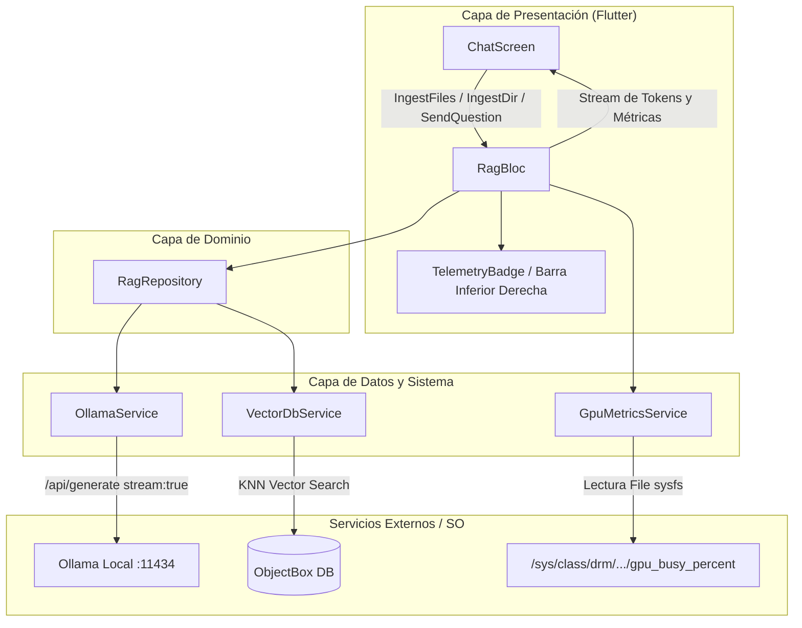

# Diseño Técnico: RAG Markdown con Streaming de Ollama y Telemetría en Tiempo Real

**Fecha:** 2026-10-21  
**Estado:** Aprobado

---

## 1. Contexto e Intención

El proyecto actual `clayton_agent` es un MVP de RAG para Linux Desktop desarrollado en Flutter, que utiliza ObjectBox para almacenar y buscar vectores locales mediante HNSW, y se comunica con Ollama (`nomic-embed-text` y `qwen2.5-coder:7b`).

Actualmente presenta las siguientes limitaciones:
1. La ingesta solo permite seleccionar carpetas completas y la UI solo muestra un texto fijo genérico (`"Carpeta Completa de Skills"`) sin revelar los nombres reales de los archivos aprendidos.
2. Existe un error en la lógica de segmentación de Markdown (`if (section.trim().length > 40) continue;`) que descarta inadvertidamente cualquier contenido mayor a 40 caracteres.
3. Las consultas a Ollama son síncronas/bloqueantes (`stream: false`), obligando al usuario a esperar que el modelo complete todo el texto antes de ver un solo carácter.
4. No existe visibilidad sobre el rendimiento del modelo (tokens por segundo) ni el uso de los recursos de hardware (GPU AMD local).

El objetivo de esta refactorización es convertir el MVP en una herramienta RAG robusta, fluida y transparente, que permita la carga selectiva de archivos Markdown o carpetas completas, transmita respuestas en streaming en tiempo real y ofrezca telemetría en vivo de velocidad y carga de GPU.

---

## 2. Metas, No-Metas y Anti-Metas

### Metas (Goals)
- **Ingesta flexible:** Permitir la selección tanto de archivos Markdown sueltos (`.md`, `.markdown`, selección múltiple) como de directorios completos recursivos.
- **Visibilidad de documentos:** Listar en el panel lateral los nombres/títulos de los archivos indexados reales.
- **Segmentación de Markdown corregida:** Segmentar respetando encabezados jerárquicos (`#`, `##`, etc.) y contenido, descartando únicamente bloques vacíos o triviales (< 20 caracteres).
- **Streaming interactivo:** Implementar streaming continuo en `OllamaService` mediante `Dio` (NDJSON), propagándolo a través de `RagRepository` y `RagBloc` para actualizar el widget `MarkdownBody` en tiempo real.
- **Telemetría en vivo:**
  - Calcular tokens por segundo en tiempo real (tokens recibidos / tiempo transcurrido) y consolidar el cálculo final exacto con las métricas devueltas por Ollama (`eval_count` / `eval_duration`).
  - Leer la carga de la GPU AMD en Linux desde el sistema de archivos del kernel (`/sys/class/drm/card1/device/gpu_busy_percent` o fallback dinámico a cualquier `card*/device/gpu_busy_percent`).
  - Presentar estas métricas de manera fija en la esquina inferior derecha debajo del área de chat.
- **Restricción de ventana:** Establecer el tamaño mínimo de la ventana de la aplicación en 800x600 px en la capa nativa GTK de Linux Desktop.

### No-Metas (Non-Goals)
- Soporte para formatos que no sean Markdown (PDF, DOCX, EPUB quedan fuera del alcance).
- Persistencia del historial de chat entre reinicios de la aplicación (el historial visual permanece en memoria de la sesión; la base de conocimiento vectorial sí persiste en ObjectBox).
- Monitoreo de GPUs remotas en red o proveedores cloud (se enfoca en la GPU local del sistema).

### Anti-Metas (Anti-Goals)
- No romper la arquitectura limpia existente (`Dio` -> `Service` -> `Repository` -> `Bloc` -> `View`).
- No bloquear el hilo principal de la UI (Flutter UI thread) durante la generación de embeddings o el streaming de tokens.
- No añadir dependencias pesadas de terceros para métricas de hardware cuando el kernel de Linux ya provee los datos directamente vía sysfs.

---

## 3. Restricciones Técnicas

- **Plataforma:** Linux Desktop (Flutter 3.x / Dart 3.x / GTK3).
- **Hardware GPU:** AMD Radeon GPU (serie Ellesmere RX 470/480/570/580/590) con interfaz de métricas en `/sys/class/drm/card*/device/gpu_busy_percent`.
- **Backend LLM:** Ollama local en `http://localhost:11434` con endpoints `/api/embed` y `/api/generate`.
  - Modelo de Embeddings: `nomic-embed-text` (dimensión 768).
  - Modelo de Generación: `qwen2.5-coder:7b`.
- **Base de Datos Vectorial:** ObjectBox con `@HnswIndex(dimensions: 768)`.

---

## 4. Decisiones Tomadas por el Usuario

1. **Ingesta dual:** Se conservará la opción de subir carpetas completas y se agregará la opción de subir archivos `.md` individuales o múltiples.
2. **Nombres de archivo:** La barra lateral de conocimiento local mostrará los títulos/nombres reales de los archivos procesados.
3. **Chat fluido con streaming:** Las respuestas se mostrarán token a token progresivamente.
4. **Ubicación de telemetría:** Las métricas de tokens por segundo y carga de GPU estarán situadas en una barra o indicador fijo en la parte inferior derecha, debajo del chat.
5. **Tamaño de ventana:** Tamaño mínimo de ventana fijado en 800x600 px.

---

## 5. Arquitectura y Componentes a Modificar

### 5.1. Capa Nativa (Linux Runner)
- **Archivo:** `linux/runner/my_application.cc`
- **Modificación:** En `my_application_activate`, aplicar `gtk_widget_set_size_request(GTK_WIDGET(window), 800, 600);` para garantizar que la ventana no pueda redimensionarse por debajo de 800x600 px.

### 5.2. Capa de Servicios (`lib/data/services/`)
- **`GpuMetricsService` (Nuevo):**
  - Servicio dedicado a leer periódicamente o bajo demanda `/sys/class/drm/card*/device/gpu_busy_percent`.
  - Manejo de excepciones y fallback seguro (si no hay permiso o no existe el archivo, devuelve 0%).
- **`OllamaService` (`lib/data/services/ollama_service.dart`):**
  - Agregar método `Stream<OllamaStreamResponse> generateResponseStream(String prompt)`.
  - Configurar Dio con `options: Options(responseType: ResponseType.stream)`.
  - Transformar el stream de bytes mediante `utf8.decoder` y `LineSplitter()`.
  - Parsear cada línea JSON y emitir fragmentos de texto progresivo (`response`) y estadísticas de finalización (`eval_count`, `eval_duration`).

### 5.3. Capa de Dominio (`lib/domain/repositories/`)
- **`RagRepository` (`lib/domain/repositories/rag_repository.dart`):**
  - **Corrección de chunker:** Corregir `_splitByMarkdownHeaders` y la condición de guardado para que chunks significativos (> 20 caracteres) se indexen y no se descarten.
  - **Ingesta de archivos individuales:** Agregar método `ingestFiles(List<String> filePaths)`.
  - **Tracking de nombres:** Devolver o registrar los nombres de archivos indexados.
  - **Streaming de consulta:** Modificar `askQuestion` o añadir `Stream<RagStreamEvent> askQuestionStream(String question)` que realiza la búsqueda semántica en ObjectBox, construye el prompt con contexto y abre el stream con Ollama.

### 5.4. Capa de Estado (`lib/presentation/blocs/`)
- **Eventos:**
  - `IngestMarkdownFilesEvent(List<String> paths)`
  - `IngestSkillsDirectoryEvent(String directoryPath)`
  - `SendQuestionEvent(String question)`
  - `ClearKnowledgeBaseEvent()`
- **Estados:**
  - `RagInitialState`
  - `RagLoadingState(String message)`
  - `FileIngestedSuccessState(List<String> fileNames)`
  - `RagStreamingState({required String question, required String accumulatedAnswer, required double currentTps, required int gpuUsagePercent})`
  - `RagResponseSuccessState({required String question, required String answer, required double finalTps, required int gpuUsagePercent})`
  - `RagErrorState(String errorMessage)`
  - `KnowledgeBaseClearedState()`

### 5.5. Capa de Presentación (`lib/presentation/views/chat_screen.dart`)
- **Sidebar:**
  - Botón "Cargar Archivo(s)" usando `FilePicker.platform.pickFiles(type: FileType.custom, allowedExtensions: ['md', 'markdown'], allowMultiple: true)`.
  - Botón "Cargar Carpeta" usando `FilePicker.platform.getDirectoryPath()`.
  - Lista de archivos cargados mostrando los nombres de archivo (`basename`).
- **Área de Chat:**
  - Renderizado dinámico del mensaje en curso con `MarkdownBody` conforme van llegando los chunks de texto.
- **Barra de Telemetría Inferior Derecha:**
  - Widget compacto en la parte inferior derecha con badges:
    - ⚡ Velocidad: `XX.X tokens/s`
    - 🎮 GPU AMD: `XX%`

---

## 6. Aspectos Delegados al Implementador (Left to Builder)

- Formateo visual fino de los badges de telemetría (colores, iconos Material 3).
- Frecuencia del sondeo de la GPU durante el stream (recomendado: 500ms - 1000ms o una lectura al finalizar cada token burst).
- Manejo de scroll automático hacia abajo en el `ListView` de mensajes a medida que el texto en streaming se expande.
